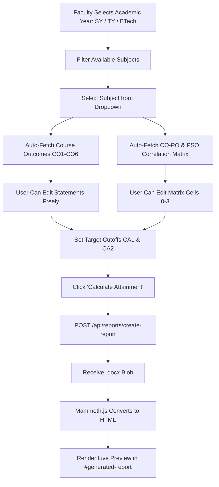

# AttenX Frontend UI: Complete Architecture, Design System & Porting Specification

---

## 1. Executive Summary & Design Philosophy

The **AttenX Frontend** is a modern, high-performance web interface designed for Higher Education Institutions to evaluate **Outcome-Based Education (OBE)** and **Course Outcome (CO) – Program Outcome (PO) Attainment** compliant with National Board of Accreditation (NBA) criteria.

### Key Architectural Strengths:
1. **Zero Tailwind Dependency (Pure Vanilla CSS Tokens)**: Built with native CSS variables for complete independence and zero build-pipeline friction. Easily portable to Next.js, Remix, Vite, or vanilla HTML/JS without PostCSS or utility-class lock-in.
2. **Spreadsheet-Grade UX**: Features bidirectional arrow-key and enter-key keyboard navigation across multi-input grids (CO statements and the $6 \times 15$ CO-PO matrix).
3. **Curriculum Auto-Fetch with Full Editability**: Pre-loaded with official NEP curriculum syllabi (79 subjects across SY, TY, and B.Tech). Selecting a subject instantaneously auto-populates Course Outcomes (CO1–CO6) and the correlation matrix while keeping every cell 100% user-editable.
4. **Client-Side Document Rendering**: Seamless integration with `mammoth.js` to render binary `.docx` reports generated by the backend directly inside the browser DOM with typography and table fidelity.
5. **Built-in Template Generator**: An offline client-side workbook builder using `xlsx` to configure dynamic columns (1–6 COs) and export formatted spreadsheet templates.

---

## 2. Technology Stack & Key Dependencies

| Dependency | Version | Purpose | Why It Was Chosen |
|---|---|---|---|
| **React** | `^19.2.8` | Core UI library | Declarative state, hooks, and clean component composition |
| **Vite** | `^8.3.0` | Build tool & Dev server | Sub-second HMR and optimized ES-module bundling |
| **React Router DOM** | `^7.18.4` | Client-side routing | Clean declarative URL paths (`/`, `/login`, `/portal`, etc.) |
| **Mammoth** | `^1.13.0` | DOCX $\to$ HTML converter | Transforms backend `.docx` binary responses into rich inline HTML previews |
| **XLSX (SheetJS)** | `^0.18.5` | Client-side Excel export | Creates styled `.xlsx` student mark collection templates in the browser |
| **Vanilla CSS** | Standard CSS3 | Styling & Theming | Centralized design tokens (`Portal.css`, `Auth.css`, `App.css`) |

---

## 3. Application Structure & Route Hierarchy

```
frontend/
├── index.html                   # HTML entry point (Inter / Roboto font imports)
├── package.json                 # Dependencies and scripts
├── vite.config.js               # Vite + React plugin configuration
└── src/
    ├── main.jsx                 # React root mount
    ├── App.jsx                  # BrowserRouter and Route switch
    ├── App.css                  # Global resets, scrollbars, and keyframe animations
    ├── index.css                # Base typography and body defaults
    ├── assets/
    │   └── attainx-logo.png     # Application logo
    ├── data/
    │   ├── curriculumData.js    # 79 NEP subjects (COs + mapping matrices)
    │   └── curriculumData.json  # Raw JSON curriculum dataset
    ├── components/
    │   ├── Landing.jsx          # Public landing / hero page
    │   ├── Login.jsx            # Sign-in screen
    │   ├── Register.jsx         # Sign-up screen
    │   ├── Portal.jsx           # Main Workbench (Attainment & Template Generator)
    │   └── ReportFormat.jsx     # Template customization preview
    └── templates/
        ├── Auth.css             # Glassmorphic card styling for auth pages
        └── Portal.css           # Complete tokenized styling for the entire workbench
```

### Route Table:

| Route | Component | Access | Description |
|---|---|---|---|
| `/` | `Landing.jsx` | Public | Brand presentation, feature grid, and entry CTAs |
| `/login` | `Login.jsx` | Public | Faculty & administrator credential authentication |
| `/register` | `Register.jsx` | Public | Account creation form |
| `/portal` | `Portal.jsx` | Protected / Main | Primary attainment workbench, auto-fetch, and report engine |
| `/reportformat`| `ReportFormat.jsx` | Feature Info | Upcoming custom report format selector |

---

## 4. Design System & CSS Token Architecture

The design system is implemented in [`Portal.css`](file:///d:/AttenX/frontend/src/templates/Portal.css) and [`Auth.css`](file:///d:/AttenX/frontend/src/templates/Auth.css) using HSL and RGB color models.

### 4.1 Theme Tokens (Light & Dark Mode)

```css
:root {
  /* Surface & Background */
  --bg: #0b0f19;
  --surface: #111827;
  --surface-2: #1f2937;
  --card-bg: #111827;
  --sidebar-bg: #0d1322;

  /* Typography */
  --text: #f9fafb;
  --soft: #d1d5db;
  --muted: #9ca3af;

  /* Borders & Dividers */
  --border: rgba(255, 255, 255, 0.08);
  --border-hover: rgba(255, 255, 255, 0.18);

  /* Accents & Highlights */
  --accent: #3b82f6;
  --accent-glow: rgba(59, 130, 246, 0.25);
  --badge-bg: rgba(255, 255, 255, 0.06);
}

/* Light Mode Overrides */
.light-mode {
  --bg: #f8fafc;
  --surface: #ffffff;
  --surface-2: #f1f5f9;
  --card-bg: #ffffff;
  --sidebar-bg: #f8fafc;

  --text: #0f172a;
  --soft: #334155;
  --muted: #64748b;

  --border: #e2e8f0;
  --border-hover: #cbd5e1;

  --accent: #2563eb;
  --accent-glow: rgba(37, 99, 235, 0.15);
  --badge-bg: #f1f5f9;
}
```

---

## 5. Portal Component Deep-Dive (`Portal.jsx`)

`Portal.jsx` is the core workbench of the application. It manages two main tabs:
1. **Attainment Calculation Workbench**
2. **Template Generator**



### 5.1 Step-by-Step Sections in the Workbench

#### Section 01: Faculty Information
- **UI Elements**: Single input pre-filled from active user state (`user.name`), with keyboard shortcut support (press $\downarrow$ to jump directly to CO inputs).

#### Section 02: Attainment Type Grid
- **Options**:
  1. `Theory Attainment` (CA-1, MSE, CA-2, ESE, CES)
  2. `Laboratory Attainment` (Continuous lab assessment + CES)
  3. `Laboratory with PR/OR` (Practical & Oral examination + CES)
  4. `Audit Course` (Non-credit / audit outcome evaluation)
- **Visual Feedback**: Selection ring with check indicator and active CSS elevation.

#### Section 03: Academic Details & Curriculum Auto-Fetch
- **Grid Layout**: Responsive 3-card grid:
  1. **Academic Year**: Dropdown (`FY`, `SY`, `TY`, `BTech`). Changing this filters the subject list dynamically.
  2. **Select Department**: Engineering branch dropdown (`Computer Science Engineering`, `Information Technology`, etc.).
  3. **Select Subject (Curriculum)**: Dynamic select dropdown listing all extracted subjects for the chosen year:
     ```jsx
     <select value={selectedSubjectCode} onChange={(e) => handleSubjectSelect(e.target.value)}>
       <option value="">-- Choose Subject (Auto-fill) --</option>
       {availableSubjects.map((sub) => (
         <option key={sub.code} value={sub.code}>
           {sub.code} - {sub.title}
         </option>
       ))}
     </select>
     ```
- **Auto-Load Banner**: When a subject is chosen, a blue badge banner appears:
  - Displays loaded course code & title.
  - Informs the user that all data has been auto-populated from NEP syllabus and remains fully editable.
  - Provides a **"Reset / Custom"** button to clear the canvas.

#### Section 04: Course Outcomes Editor
- **Inputs**: 6 vertical rows (`CO1` to `CO6`).
- **Keyboard Navigation**:
  - Pressing $\downarrow$ or `Enter` moves focus to the next CO.
  - Reaching the last CO moves focus into the first cell of the correlation matrix.
  - Pressing $\uparrow$ moves focus back to previous COs.

#### Section 05: CO / PO & PSO Correlation Matrix
- **Matrix Dimension**: 6 rows $\times$ 15 columns:
  - **Program Outcomes**: `PO1` to `PO12`
  - **Program Specific Outcomes**: `PSO1`, `PSO2`, `PSO3`
- **Spreadsheet Navigation**: Arrow keys ($\leftarrow, \rightarrow, \uparrow, \downarrow$) seamlessly move cursor focus across rows and columns.
- **Actions**: "Clear All" button resets matrix values to empty.

#### Section 06: Targets & Data Ingestion
- **Attainment Targets**: Sliders/inputs for CA-1 (default 60%) and CA-2 (default 60%).
- **File Dropzone**: Accepts `.csv`, `.xls`, `.xlsx` marksheets for student marks ingestion.

#### Section 07: Live Report Generator & Preview
- **Action**: "Calculate Attainment" button with loading spinner state (`isGenerating`).
- **Backend Dispatch**:
  ```javascript
  const response = await fetch("http://localhost:5000/api/reports/create-report", {
    method: "POST",
    headers: { "Content-Type": "application/json" },
    body: JSON.stringify({
      attainmentType,
      facultyName,
      academicYear,
      department,
      courseCode: selectedSubjectCode,
      courseTitle: selectedSubjectTitle,
      targetCA1,
      targetCA2,
      cos,
      mapping,
    }),
  });
  ```
- **Rendering**: Converts binary blob using `mammoth.convertToHtml` and scrolls smoothly to `#generated-report`. Includes a "Download Word Report (.docx)" button for the raw file.

---

## 6. Template Generator (`activeTab === 'template'`)

For teachers who need blank, formatted marksheets before evaluation:
- **Interactive Controls**:
  - Course Name input
  - Dynamic CO Count selector (1 to 6 COs)
  - Interactive table preview with inline editing
- **Export Formats**:
  1. **Excel (.xlsx)**: Generates workbook using `XLSX` with bold headers, custom column widths (`wch: 22` for Name, `wch: 16` for PRN, `wch: 10` for marks), and 15 blank rows for data entry.
  2. **CSV (.csv)**: Generates standard comma-separated values file.

---

## 7. State Schema & Curriculum Data Format

The curriculum database in [`frontend/src/data/curriculumData.js`](file:///d:/AttenX/frontend/src/data/curriculumData.js) exports an array of subjects formatted as:

```javascript
export const curriculumSubjects = [
  {
    code: "23CS2301",
    title: "Mathematics for Computer Science",
    academicYear: "SY", // "SY" | "TY" | "BTech"
    cos: {
      CO1: "Apply the operations of sets, use Venn diagrams...",
      CO2: "Write an argument using logical notation...",
      CO3: "Identify the appropriate algebraic structure...",
      CO4: "Illustrate and formulate fundamental probability...",
      CO5: "Apply different methods to find correlation...",
      CO6: "Apply various statistical tests to test hypothesis."
    },
    mapping: {
      CO1: { PO1: "2", PO2: "2", PO7: "1", PO11: "1", PSO1: "2" },
      CO2: { PO1: "2", PO2: "2", PO7: "1", PO11: "1", PSO1: "2" },
      CO3: { PO1: "2", PO2: "2", PO7: "1", PO11: "1", PSO1: "2" },
      CO4: { PO1: "2", PO2: "2", PO5: "1", PO7: "1", PO11: "1" },
      CO5: { PO1: "2", PO2: "2", PO5: "1", PO7: "1", PO11: "1" },
      CO6: { PO1: "2", PO2: "2", PO5: "1", PO7: "1", PO11: "1" }
    }
  },
  // ... 79 total subjects
];
```

---

## 8. Step-by-Step Guide to Port this UI to Another Project

If you are porting this frontend into another repository, framework (e.g. Next.js, Remix, Vite), or team:

### Step 1: Install Dependencies
```bash
npm install react react-dom react-router-dom mammoth xlsx
```

### Step 2: Copy CSS Stylesheets
Copy the following files into your styles directory:
- `templates/Portal.css` $\to$ Core design tokens, forms, matrix tables, and report preview styles.
- `templates/Auth.css` $\to$ Glassmorphic styling for Login and Register pages.
- `App.css` $\to$ Animations and scrollbar styling.

### Step 3: Copy Curriculum Data
Copy `src/data/curriculumData.js` and `curriculumData.json` into your new project's data directory.

### Step 4: Import Components
Copy `components/Portal.jsx`, `components/Login.jsx`, `components/Register.jsx`, and `components/Landing.jsx`.

### Step 5: Configure Backend API Base URL
In `Portal.jsx`, abstract the backend URL to an environment variable:
```javascript
const API_BASE = import.meta.env.VITE_API_URL || "http://localhost:5000";

// When calling report generation:
const response = await fetch(`${API_BASE}/api/reports/create-report`, { ... });
```

---

## 9. Visual UI Reference Checklist

When validating the ported UI, verify these visual and behavioral checkpoints:
- [x] **Theme Toggle**: Clicking appearance switch smoothly toggles dark and light mode without reloading.
- [x] **Card Selection**: Attainment type cards highlight with a distinct blue border when selected.
- [x] **Year $\to$ Subject Filtering**: Selecting `SY` shows SY subjects (e.g. Mathematics, Data Structures), `TY` shows TY subjects (e.g. Advanced Java, DAA), and `BTech` shows BTech subjects (e.g. Cloud Computing).
- [x] **Auto-Fetch**: Choosing any subject immediately populates CO1–CO6 statements and matrix levels.
- [x] **Editability**: Modifying any CO text or matrix number updates state instantly without resetting.
- [x] **Matrix Arrow Navigation**: Using keyboard arrow keys traverses cells across columns and rows like Microsoft Excel.
- [x] **Inline Report Rendering**: Submitting the form renders the formatted NBA accreditation document with institutional header, subject code, title, and signature blocks.
